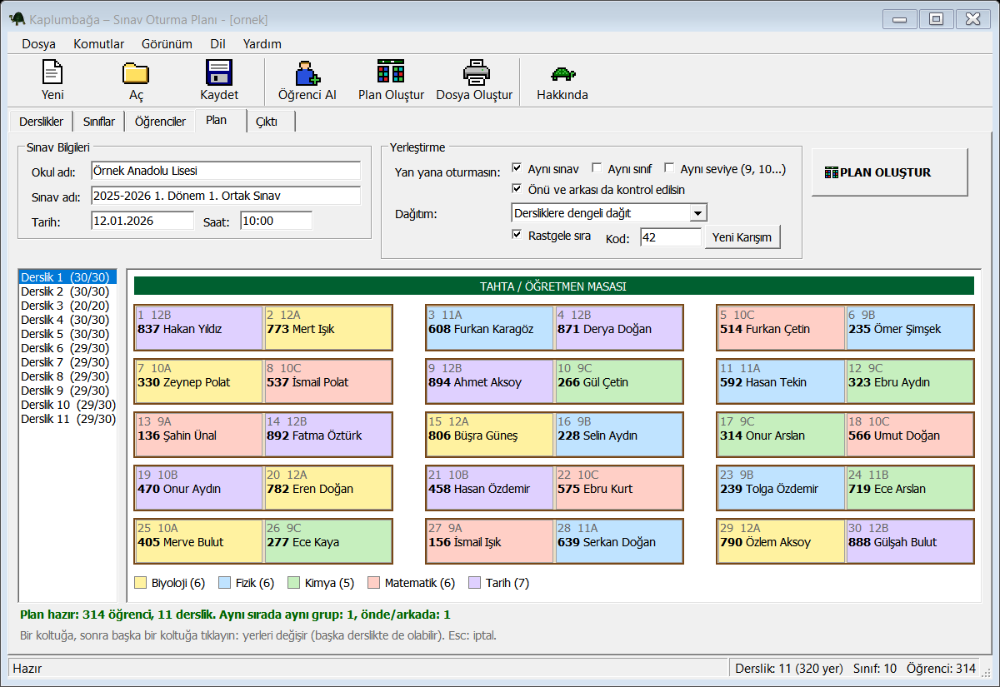

<p align="center"></p>

<h1 align="center">Kaplumbağa – Sınav Oturma Planı</h1>
<p align="center"><b>Exam Seating Plan</b> · v1.0 · Windows 7 / 8 / 10 / 11 · Ücretsiz / Free</p>

<p align="center">
  <a href="Kaplumbaga-Setup-1.0.exe"><b>⬇ Kurulum / Installer</b></a> (2.1 MB) &nbsp;·&nbsp;
  <a href="Kaplumbaga-1.0-portable.zip"><b>⬇ Taşınabilir / Portable .zip</b></a> (124 KB)
</p>



## Türkçe

Ortak sınavlar için **derslik oturma planı** ve **sınıf listelerini** dakikalar içinde hazırlayan küçük, ücretsiz bir program.
Reklam yok, internet gerekmez; veriler bilgisayarınızda kalır.

- Öğrencileri **Excel (.xlsx, .xls), CSV ve e-Okul** listelerinden alır.
- **Aynı sınava, sınıfa veya seviyeye** giren öğrencileri yan yana ve önlü-arkalı oturtmaz.
- Her sınıf için "sınav yerleri" listesi, her derslik için renkli **oturma şeması**, imza yerleri ve sınava göre sayılar.
- Sıra etiketleri, genel liste ve özet · **PDF, Word, Excel, CSV** · Türkçe ve İngilizce.

**İndirme:** yukarıdaki bağlantıya tıklayın, açılan sayfada **Download** (indir) düğmesine basın.

**"Windows bilgisayarınızı korudu" uyarısı çıkarsa:** program ücretli bir dijital imzaya sahip olmadığı için çıkar.
**Ek bilgi** → **Yine de çalıştır**'a basın.

**Kullanım:** 1) Derslikler · 2) Öğrenciler (dosyadan al) · 3) Sınıflar (sınav adları) · 4) Plan Oluştur · 5) Dosyaları Oluştur

## English

A small free tool that builds **exam seating plans** and **class lists** for school exams in minutes.
No ads, works offline; your data stays on your computer.

- Imports students from **Excel (.xlsx, .xls), CSV and Turkish e-Okul** lists.
- Keeps students with the **same exam, class or grade** apart — side by side and front/back.
- A "where do I sit" list for every class, a colour **seating chart** for every classroom with signature space and counts per exam.
- Desk labels, master list and summary · **PDF, Word, Excel, CSV** · Turkish and English.

**Download:** click a link above, then press **Download** on the page that opens.

**If Windows says "Windows protected your PC":** it appears because the program has no paid digital signature.
Click **More info** → **Run anyway**.

**How to use:** 1) Classrooms · 2) Students (import) · 3) Classes (exams) · 4) Generate Plan · 5) Create Files

## Gereksinimler / Requirements

Windows 7 SP1 or later. Nothing to install on Windows 7 (.NET 3.5 is built in) or Windows 10/11 (.NET 4 is built in).
In the portable version keep `Kaplumbaga.exe` and `Kaplumbaga.exe.config` together.

**SHA-256**
```
88fbf9f76742f659e42dafc0554974699bd4e5fe82694fd1704df1c734dcfec9  Kaplumbaga-Setup-1.0.exe
4faa7ad171bd54c6ddc9fa4879775b101e51c3cc4e4c5b40f49529996b3d7409  Kaplumbaga-1.0-portable.zip
```

## İletişim / Contact

kaplumbaga.app@gmail.com

Made by **OAS** · © 2026 · [MIT License](LICENSE.txt)
